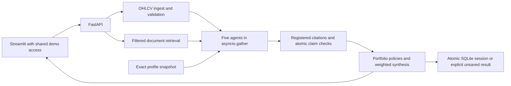

# Architecture and verification boundaries

## Flow and contracts

Pydantic preserves the original Citation, AgentOutput, UserProfile and Recommendation
fields. Citation adds a date. AgentOutput adds EvidenceClaim records with claim ID,
text, citation IDs, method and optional fact key/value/unit. Recommendation adds
decision_basis, confidence_kind and policy_rules. Fractions and confidence must be
finite. Behavior fields used by policies are validated.

All five agents use thread-backed workers with a five-second waiting timeout.
A real barrier test establishes overlapping execution. This does not guarantee CPU
speedup: CPython scheduling and the GIL affect these small calculations.
Timed-out worker threads cannot be forcibly killed; they may complete later, and
loop shutdown may wait for them. Production hard isolation remains unimplemented.

The engine also bounds market/retriever initialization and queries. Invalid markets
are not charted; failed retrieval withholds textual claims. Corpus files with invalid
metadata are skipped with explicit warnings. Optional model failures disable that
backend for the Retriever instance and retain BM25.

## Signals and financial extraction

| Agent | Method | Confidence meaning |
|---|---|---|
| Momentum | Wilder-style RSI14, EMA12/26 MACD, SMA20/50, 20-session return | Absolute normalized trend score; neutral uses distance from directional threshold |
| Volume | Latest z-score against previous 30 sessions; 5-session volume ratio and price divergence | tanh anomaly strength; normal confidence is distance from anomaly threshold |
| Sentiment | Finite financial phrases and same-clause negation in news | Normalized signed lexical evidence; does not model arbitrary language |
| Filings | Extracts supported financial facts and guidance/risk flags, with source quotations | Combined deterministic fact/tone strength; not a trained fundamentals forecast |
| Risk | Portfolio position, normalized equity HHI, equity sector exposure, cash allocation | Separation from disclosed policy thresholds; not probability of losses |

Momentum score:
`s=.45*tanh(12*r20)+.35*tanh(30*(SMA20/SMA50-1))+.15*tanh(500*MACD_hist/price)+.05*(RSI-50)/50`.
Directional threshold is ±.15. Flat RSI is 50; zero-loss rising RSI is 100.
Volume strength uses max(abs(z)/4,(1-ratio)/.5) for divergence, with a .8 volume-ratio
threshold. OHLCV must be finite, complete, positive-price and internally consistent.

Financial templates extract revenue/profit/operating-profit signed changes, explicit
margins and percentage-point changes, debt changes/amounts, guidance changes, weak
demand and legal/regulatory statements. Forecast-qualified text stays qualified.
Simple negation covers no growth, not strong and absent/resolved litigation.
Complex accounting, distant negation, sarcasm and general causal interpretation
remain outside these finite rules.

## Retrieval and evidence

Each Markdown document has a JSON metadata header. Its date is the availability
date. Ingestion stores original body text and chunks at 120 words with 20-word
overlap, preserving exact character spans including whitespace. Therefore source
passages can be highlighted in the original document.

BM25: k1=1.5, b=.75, IDF=log(1+(N-df+.5)/(df+.5)); relevance=score/(score+1).
Ticker, document type and optional as_of date filters apply before ranking.
HDFCBANK intentionally has news but no filing.

Optional local CPU MiniLM plus Chroma ranks are fused with reciprocal rank fusion.
The model revision is pinned. A model/corpus fingerprint isolates indexes; only
the matching index is reconciled, not another corpus's active collection.
Chroma telemetry is disabled. Successful real MiniLM retrieval has not been
verified because model downloads are blocked. Real Chroma fixture-vector tests are
reported separately; they are not neural retrieval evidence.

Citation validation matches chunk ID, source ID, title, date, excerpt and relevance
score against the session registry. Statement validation:
- quotation: exact text from registered source;
- financial_fact: independently re-extract the exact fact/template/quantity;
- computed: exact approved market/profile statement regenerated from inputs.

One authorization supports one displayed evidence statement. Duplicate/orphan
claims, changed quantities, unsupported substitutions and empty-rationale signals
are rejected. Signal label/confidence must match deterministic recomputation before
claims are retained; unsupported fractions reduce strength. Failed outputs are
UNKNOWN/0 with no evidence.

These checks do not establish generic semantic entailment or factual truth. The
synthetic passages remain fabricated. Policy reasoning is an arithmetic/rule trace
over validated inputs, not an LLM reasoning chain.

## Portfolio policies

Total HHI=sum of squared total weights, including cash, is descriptive.
Equity HHI excludes cash and normalizes equity weights to sum to one; it is zero
when no equities exist. Sector weights use the total portfolio denominator.
Cash is an allocation, not automatically high equity risk.

The selected stock exceeding the user's limit triggers REDUCE before market
completeness checks. Its explanation cites the profile; absent filings are never
invented. Missing usable momentum or filings otherwise causes WATCH. Opposing
directional evidence causes HOLD. Negative score below -.25 selects REDUCE if held
or AVOID if unheld. Conservative entries require score>.65 and volatility<30%;
moderate entries stage above .30; aggressive entries can BUY above .30.

Additional entry guards:
- stock at limit: pause an increase;
- target equity sector at or above 50%: pause purchases in that sector;
- equity allocation>=50% with normalized equity HHI>.40: pause adding to largest holding;
- unavailable cash: do not suggest a cash-funded purchase;
- horizon<=6 months: volatility caps 30% conservative/moderate, 60% aggressive;
- momentum-chasing behavior: require a cited, non-degraded supportive filing
  with strength>=.5 before new exposure.

Panic-selling and short holding history produce reassessment nudges, not forecasts
or automatic trading. These fixed thresholds are demo policies, not empirically
validated suitability. Current HHI guards do not optimize every prospective trade
or model correlations.

Synthesis weights momentum .30, volume .15, sentiment .20, filings .35. Risk is a
guardrail, not a directional vote. Failed outputs contribute zero; degraded outputs
receive half weight. Full denominator is retained. Each opposing pair reduces raw
confidence by .15, capped at a total .5 penalty. confidence_kind=evidence_strength
is uncalibrated market evidence; decision_basis distinguishes portfolio-policy,
incomplete-evidence, conflict-resolution and market-evidence actions.

What-if transfers up to five percentage points between stock and cash, bounded by
position/sector limits and available cash. It preserves total weight, never mutates
actual holdings and has no costs, optimizer or predicted returns. Total HHI can rise
after selling into cash while equity concentration falls.

## Persistence, API and dashboard

Each session includes its final trace and is inserted in one SQLite transaction.
Connections close after commit/rollback. If storage fails, the response is usable
but persistence.status=failed; inline source documents remain available and decision
writes are disabled. No failed configured database is silently redirected elsewhere.

Unavailable profile storage uses disclosed read-only seeds; customized profiles are
not treated as recovered. Storage-only mutations/history return 503, missing records
404, malformed requests 422. Health reports discovered degradation. The HTTP
Server-Timing header measures backend request processing; stored compute latency
excludes HTTP and persistence. Unknown unexpected bugs are not a promise of immunity
to every possible process or infrastructure failure.

Profile forms preserve behavior and validate weights; cached analyses include
profile signatures. Dashboard API failures become actionable messages. Beginner
mode hides analyst evidence/strength numbers, while actual source transparency
remains available. Sources show an escaped original-document view with exact spans.

VIBEFINANCE_API_TOKEN provides shared Bearer/password access. External launcher
bindings require it. This is not per-user accounts or privacy isolation. The
Docker setup runs non-root, keeps API loopback-only, and persists SQLite on /data.
Public hosting is not provisioned.

## Evaluation and timing

Technical evaluation uses 12 independent seeds × 5 uninjected synthetic price paths
× 600 sessions. Constant drift/volatility are disclosed. Targets use 30 subsequent
trading sessions with no overlapping target windows per path; neutral signals
abstain. Momentum, random and always-up directions share the scored dates.

Probability calibration targets P(next 30-session return>0), using Laplace-smoothed
up rates conditioned on the label and only matured previous observations on that
path. It does not calibrate recommendation confidence. Brier baselines, seed-cluster
bootstrap intervals, paired differences and sample/abstention counts are reported.

Separate policy evaluation uses independent dated synthetic financial/news fixtures.
Only sources available at each cutoff are indexed. All five agents and three
profiles are replayed; checks cover concentration precedence, cash classification
and date visibility. Action-conditioned returns are descriptive, not profitability,
causal benefit or action-success probabilities.

The benchmark warms both modes, alternates order, uses identical inputs and compares
outputs. It measures real sequential and parallel compute windows without delays.
Persistence, HTTP and downloads are excluded. Local results may show a slowdown;
neither concurrency nor synthetic accuracy demonstrates a production advantage.

## Remaining limits

No real filing/PDF ingestion, licensed news, neural-model success, successful live
feed, optional LLM narration, calibrated recommendation-success model, trading
simulation, transaction costs, portfolio optimization or regulatory approval.
Shared demo access is not multi-tenant security. Public hosting and native macOS
operation are unverified. See docs/VALIDATION.md and docs/HANDOFF_FOR_CLAUDE.md.
