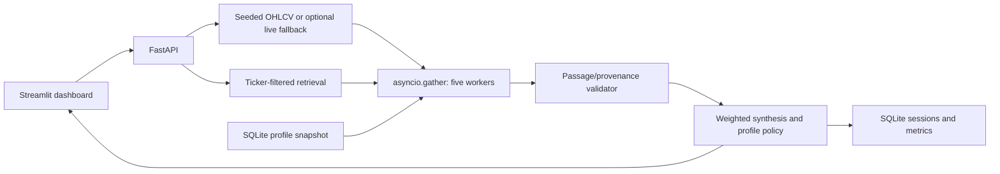

# Architecture

## Execution

`orchestrator.analyze` prepares immutable data snapshots and retrieves filings/news,
then invokes momentum, volume, sentiment, filings and portfolio risk through
`asyncio.gather`. Each computation runs through `asyncio.to_thread`, with a 5-second
timeout and a timing/exception boundary. CPU-heavy work is not parallelized across
processes; these small computations primarily demonstrate independent scheduling.
Timed-out Python threads cannot be forcibly stopped and may finish in the background.
Retrieval and optional live ingestion occur before the five-agent window. No LLM runs.

The API owns a persistent Store and Retriever. The dashboard calls the API; it does
not maintain a second analysis engine. Compare-users shares one frame and retrieval
index with all profiles. Session history is independent of current profile edits.

## Contracts and agents

Pydantic models in `agents/base.py` follow the blueprint's Citation, AgentOutput,
UserProfile and Recommendation contracts. Citation adds a backward-compatible date
field. Confidence is finite and constrained to [0,1]; list defaults use factories.
Profiles reject invalid fractions. AgentOutput includes status, timing, numeric
evidence and exact citations; failures return UNKNOWN/0 with no assertions.

| Agent | Computation and labels | Confidence formula |
|---|---|---|
| Momentum | Wilder-style exponentially smoothed RSI(14), EMA12−EMA26 MACD, 20/50 SMA, 20-session return; BULLISH/BEARISH/NEUTRAL | `s=.45*tanh(12*r20)+.35*tanh(30*(SMA20/SMA50−1))+.15*tanh(500*MACD_hist/price)+.05*(RSI−50)/50`; directional if abs(s)>.15, confidence abs(s); neutral confidence `1−abs(s)/.15` |
| Volume | Latest volume vs previous 30 sessions; SPIKE_UP/SPIKE_DOWN/NORMAL; warning if price rises while volume ratio<.8 | z-score with population std; strength `max(abs(z)/4,(1−ratio)/.5)` for divergence; anomaly confidence tanh(strength), normal `max(0,1−abs(z)/2)` |
| Sentiment | Counts an explicit positive/negative lexicon in retrieved synthetic news; POSITIVE/NEGATIVE/MIXED | `t=(positive−negative)/(positive+negative+1)`; directional confidence abs(t); mixed `1/(positive+negative+1)` |
| Filings | Same transparent tone rule across top-k retrieved filings; SUPPORTIVE/CAUTIONARY/UNKNOWN | abs(t), label threshold ±.1; missing documents confidence 0 |
| Risk | Position/limit, portfolio HHI, largest equity sector; RISK_LOW/MED/HIGH | severity=max(position/limit,HHI/.4,sector_weight/.5); high if position>limit or severity>1.25; medium if >.75; confidence `1−exp(−2*abs(severity−boundary))`, boundary 1.25 for high, .75 otherwise |

RSI is 50 for flat prices and 100 when gains occur with zero losses. There is no
division by zero for constant volume. Market validation checks completeness,
finiteness, nonnegative volume, positive prices and consistent OHLC bounds.

Risk confidence describes threshold separation, not a loss probability. HHI includes
cash; a cash-heavy portfolio can be concentrated under that definition without large
equity exposure. Sector exposure is computed separately. The risk label does not
automatically veto a trade; the explicit position-limit check does.

## Retrieval and attribution

The 21 Markdown documents contain a JSON metadata header: source_id, ticker,
doc_type, date and title. Ingestion chunks at 120 words with 20-word overlap. Ticker
and document-type filters apply before ranking. HDFCBANK has news but no filing.

BM25 uses k1=1.5, b=.75 and log(1+(N−df+.5)/(df+.5)); relevance is `score/(score+1)`.
The optional local-only MiniLM/Chroma path fuses embedding ranks and BM25 ranks using
reciprocal rank fusion with denominator 60+rank. RRF scores are scaled by 30; neither
score is a probability. Chroma stores ticker/type metadata and filters both. Missing
model/dependencies/index/query falls back to BM25 and records the reason. The offline
default is BM25, not a claim that a neural model has been exercised.

Every retrieved passage is registered for the session. The validator rejects citations
whose source ID, chunk ID, title, date or excerpt differs from the registry. On
rejection it removes the agent's evidence, zeroes confidence and marks degradation.
Momentum/volume cite generated indicator snapshots; risk cites the exact input
profile, clearly distinguished from document citations. Synthesis is an arithmetic
and policy trace grounded in these outputs; it introduces no external market facts.
The UI offers the stored source passage for inspection. Registry validation proves
provenance, not semantic entailment or truth. Optional LLM narration is not enabled.

## Synthesis and personalization

Weights: momentum .30, volume .15, sentiment .20, filings .35. Risk is a separate
guardrail, not a directional vote. Failed outputs contribute zero; degraded outputs
receive half weight. Directional labels vote ±1 and neutral labels 0. Raw score is
the sum of weight × confidence × sign. Raw confidence sums weight × confidence,
retaining the full denominator so absent evidence never inflates certainty.
Every opposing directional pair adds a visible conflict. Final confidence is
`raw_confidence * (1−min(.5,.15*conflict_count))`.

Policies execute in this order:

| Condition | Result |
|---|---|
| Missing usable momentum or cited filings | WATCH; do not invent actionable fundamentals |
| Held stock exceeds profile limit | REDUCE; gradual concentration rebalance overrides direction |
| Any directional conflict | HOLD; pause additional exposure |
| Score<−.25 | REDUCE if held, otherwise AVOID |
| Conservative | ACCUMULATE only if score>.65 and annualized volatility<30%, otherwise HOLD |
| Moderate | ACCUMULATE above .30, otherwise HOLD |
| Aggressive | BUY above .30, otherwise WATCH |

Horizon<=6 months adds drawdown context. Momentum chasing adds a confirmation/FOMO
nudge. Two or more panic sells add gradual-exit language. Average holding period<30
days adds a reassessment nudge. These are explicit rules, not inferred psychology.
Identical RELIANCE inputs yield Meera REDUCE (22% holding vs 15% limit), Arjun
ACCUMULATE and Rohan BUY. ITC/Meera independently demonstrates 45% concentration.

## Degradation matrix

| Failure | Behaviour |
|---|---|
| Optional live feed import/request/data invalid | Deterministic simulated frame; mode and warning exposed |
| Optional embedding path unavailable | BM25 retrieval and warning |
| Sentiment outage (ITC seeded or toggle) | MIXED, degraded, 0 confidence, no sentiment claims |
| Missing filing (HDFCBANK seeded or toggle) | UNKNOWN, degraded, 0 confidence, no fundamental claims; WATCH |
| Invalid OHLCV | Momentum/volume failed; others finish; WATCH |
| Agent exception/timeout | Failed output with 0 confidence; remaining agents finish |
| Forged/altered citation | Evidence removed, confidence 0; degraded status |
| All agents fail | WATCH, 0 confidence, profile snapshot only; UI says market evidence unavailable |
| API unavailable | Dashboard shows restart guidance rather than fabricated results |

Unsupported request tickers and malformed profiles receive 422; missing records 404.
SQLite/storage errors are operational errors, not silently successful persistence.

## Metrics and evaluation

Sessions store individual agent latencies, parallel-window wall time, compute latency
(including ingestion/retrieval/synthesis; excluding persistence/HTTP), sum of wrapped
agent timings and their ratio to the parallel window. The sum is an overlap estimate,
**not measured sequential speedup**; scheduling and GIL contention affect it.

HHI is the sum of squared portfolio fractions, including cash. The what-if transfers
up to five percentage points from cash to stock for BUY/ACCUMULATE (bounded by the
limit), or stock to cash for REDUCE; other actions transfer zero. Both weights sum to
one. It is an illustration, not an optimizer, and HHI can increase or decrease.
Top holding excludes cash. Real holdings are never changed by the what-if.

Citation coverage counts evidence bullets from agents with valid provenance divided
by total emitted evidence bullets; no evidence gives N/A. It does not count every
grammatical claim or audit semantic truth. Degraded and failed counts are distinct.

Evaluation predicts bullish/bearish technical direction at non-overlapping cutoffs
beginning with 60 sessions, stepped by 30. Only historical prefixes reach indicators.
Forward return uses exactly 30 subsequent trading sessions; neutral signals are
excluded. Hit rate, seeded random baseline and always-up baseline use the same
observations. Mean forward return is grouped by label. Up probability is
`0.5 ± directional_confidence/2`; five buckets plot mean forecast vs realized-up rate.
Brier score is mean squared error of forecast vs realized-up indicator. Sample size
and limitations are always shown. No historical filings are used in this technical
evaluation, so it is not an evaluation of personalized actions.
Each session also stores the current deterministic technical hit rate, sample size
and Brier score alongside its own latency/provenance/portfolio metrics.

## Data disclosure and known limitations

Seed 42 plus stable ticker offsets generates 300 business sessions ending 2026-09-30.
Final-window trends, RELIANCE volume spike and INFY participation decline are injected
to exercise demos, not discovered investment opportunities. Documents are fabricated
and dated 2026-09-25. Demo outcomes are deterministic; UUIDs and timings vary.

This is a local educational prototype: no brokerage execution, authentication,
regulatory approval, licensed live feeds, transaction costs, market calendar/holiday
model, corporate actions, historical fundamentals, portfolio optimizer or proven
investment edge. Lexicon sentiment is crude and cannot handle complex negation.
Optional model/live-feed successful integration is separate from core readiness.
